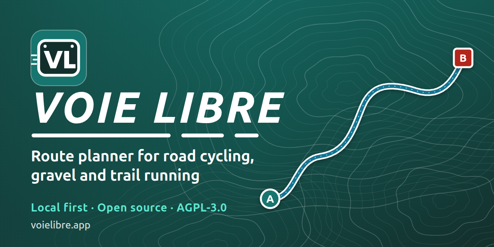

# Voie Libre

**Plan road, gravel and trail routes in your browser, free and without an account.**

**[Open Voie Libre → voielibre.app](https://voielibre.app)**

## For everyone

### What is it?

Voie Libre is a route planner for road cycling, gravel riding and trail running. You pick a start and an end on the map, choose what you ride or run on, and it draws the best route along roads and paths that suit you, with the climb and the surface of the way. It is open source, free, and has no advertising.

It works well on a phone as well as on a computer, and your routes stay on your device unless you decide otherwise. For now the map and the routing cover metropolitan France.

### What you can do

**Plan a route**

- **Click the map** to set the start, then each place you want to go through (on a phone, press and hold). The route goes on after the last point until you press **Finish here**; **Continue the route** opens it again. Or type the start and the end in the search fields, or use **My position**, with the button at the end of each field.
- **Shape it:** drag the route to bend it, drag a marker to move a point, add a stop between two places with the **+**, reorder the stops, remove one, and undo or redo (Ctrl/Cmd+Z, or the buttons). On a long route only the stretch you changed is computed again.
- **Choose your sport:** road bike, gravel bike or trail running, each with its own idea of a good way. On road and gravel a point you place snaps to the nearest suitable way. A layer of the map shows which ways suit the profile you picked.
- **Compare up to three alternatives** for the same trip.
- **Ride a loop:** come back to the start, avoid the way you came by, or let the planner draw a loop of the **distance or the duration** you want (from your own speed, which you can change for each sport), with a climb to aim for and a direction. A loop can be done several times in one file, handy for a race.

**Read the route**

- **Elevation profile** under the map, coloured by grade (descents left plain on road and gravel, coloured on trail, and you can switch it). Hover it to see a point on the map, or drag over it to measure a stretch: a bubble gives its distance, climb, descent and average grade, with a button to zoom the map on it.
- **Colour the route** on the map by what it rides on (paved road, cycle track, unpaved way, path) or by its grade, or leave it plain. Light arrows show the way it goes: one arrow where you ride a stretch once, a double arrow where you ride it both ways (an out-and-back).
- **Shaded relief**, and aerial photos if you ask for them.

**Keep it, share it, take it with you**

- **Save routes** on your device, and **export** them as GPX or FIT files for your phone, bike computer or watch. **Import** a GPX file.
- **Go offline:** keep the area of a route (or of what is on screen) on your device and open it with no network.
- **Install the app** on your phone or computer (the "i" window, or your browser's menu), to open it from its own icon.
- On a phone, the panel is a **bottom sheet** you swipe up and down; the map keeps the whole screen when you do not need the panel.
- **English or French.**

### Your routes and your privacy

- Saved routes live in your browser, on your device. There is no account.
- To compute a route or search for a place, the app sends the points or the words concerned to the server. There are no analytics and no advertising.
- The shaded relief (on by default) is read from public terrain tiles hosted by Amazon, and the aerial photos (optional) from the French IGN: those servers see your address and the area you look at. You can switch the relief off, and the aerial photos stay off until you tick them; the map itself comes from this app's own server.
- Your position is only used on your device, when you press the position button.

### Help the project

Voie Libre is free and has no advertising. The server and the domain name are paid for by its author. If it is useful to you, you can [support it on Liberapay](https://liberapay.com/sroucheray).

Found a problem, or have an idea? [Open an issue](https://github.com/sroucheray/voie-libre/issues). The code is open: see [CONTRIBUTING.md](CONTRIBUTING.md) if you want to look at it or to contribute.

---

## For contributors

The code, the documentation of each feature and how to run the project locally are in [CONTRIBUTING.md](CONTRIBUTING.md). The architecture is in [docs/architecture.md](docs/architecture.md), and the brief and the story of each feature in [docs/features](docs/features/README.md).

## License

[AGPL-3.0-only](LICENSE).
